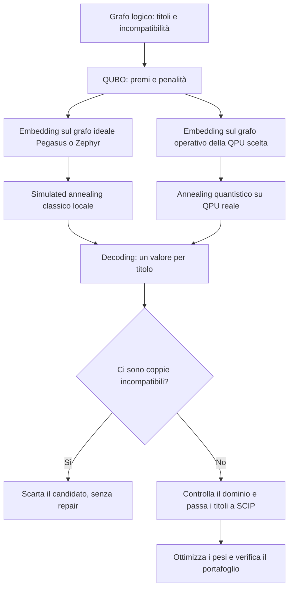
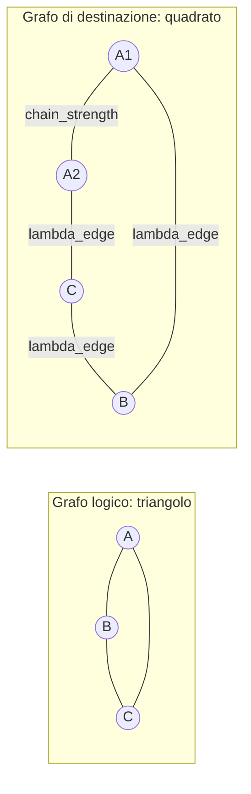
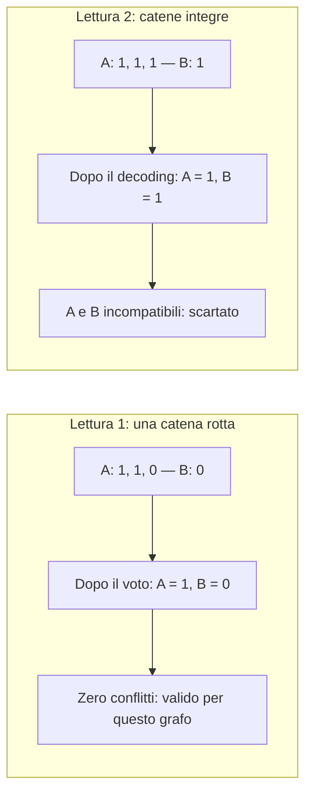

# D-Wave in QReduce: guida visuale

**Il QUBO dice che cosa ottimizzare. La topologia dice quali collegamenti si possono usare. L'embedding adatta il problema a quei collegamenti. Il campionatore cerca candidati.** Un embedding corretto non garantisce che il campionatore trovi un candidato valido.

I diagrammi sono in Mermaid; le didascalie restano leggibili anche senza rendering.

## 1. Dove interviene D-Wave?

Nel **grafo logico**, un nodo è un titolo e un arco indica che due titoli non devono essere tenuti insieme nella fase di riduzione. La variabile binaria `δ_i` vale `1` se il titolo resta disponibile a SCIP e `0` altrimenti. Non è il peso del titolo nel portafoglio: quello è una variabile continua, `x_i`, che viene decisa dopo.

Il **QUBO** è la funzione da minimizzare: premia i titoli di maggior peso MIS e aggiunge `lambda_edge` per ogni coppia incompatibile selezionata. Qui *energia* è il valore della funzione obiettivo. Un candidato con zero conflitti è un insieme indipendente valido; per essere ottimo deve anche avere il massimo peso totale. Il peso MIS e lo Sharpe finale misurano due cose diverse.

**Pegasus** e **Zephyr** sono topologie, ossia schemi di collegamento tra qubit. Le QPU **Advantage** usano Pegasus; le **Advantage2** usano Zephyr. Nei test locali di QReduce, `pegasus_p16` e `zephyr_z12` sono grafi ideali: il campionatore è classico e non riproduce la fisica della QPU. Il ramo QPU nel diagramma è il percorso su hardware, non quello usato nei test. Una QPU reale può avere qubit o collegamenti non disponibili: un embedding locale va verificato sul suo grafo operativo prima di riusarlo.

## 2. Perché un titolo può occupare più nodi?

Tre titoli incompatibili a coppie formano un triangolo. Supponiamo che il grafo di destinazione sia invece un quadrato, senza diagonali. Il triangolo non si può disegnare su tre dei suoi nodi mantenendo tutti e tre i collegamenti. La soluzione è usare due nodi adiacenti per rappresentare il titolo A.

**L'embedding** è la corrispondenza: A occupa la catena A1–A2, B e C occupano un nodo ciascuno. L'arco A–B è rappresentato da A1–B; l'arco A–C da A2–C; l'arco B–C resta diretto. Il quadrato è un esempio didattico, non una raffigurazione di Pegasus o Zephyr. Le etichette indicano il ruolo dei collegamenti, non i valori numerici programmati su una QPU.

- **`chain_strength`** agisce *dentro* la catena: favorisce l'accordo tra le copie dello **stesso titolo**.
- **`lambda_edge`** agisce *tra* titoli: penalizza la scelta contemporanea di **due titoli incompatibili**.

Catene troppo deboli possono rompersi spesso. Nel simulatore, catene molto rigide possono invece ostacolare il passaggio da una scelta all'altra: aggiornare una sola copia può aumentare temporaneamente l'energia, anche quando cambiare l'intera catena sarebbe vantaggioso.

## 3. Catena integra e candidato valido non sono la stessa cosa

Nell'esempio seguente A e B sono incompatibili. Per rendere inequivocabile il voto di maggioranza, usiamo qui una catena di tre nodi per A.

Il **decoding**, detto anche *unembedding*, ricava una decisione per titolo. Il voto di maggioranza risolve il disaccordo tra copie; non verifica gli archi di incompatibilità. La **validazione MIS** conta quei conflitti e può scartare il campione senza modificarlo. Il **repair**, invece, cambierebbe la selezione logica per cercare di eliminare i conflitti: non è stato usato nelle prove riportate qui.

## Scheda rapida dei parametri

| Parametro | Che cosa controlla |
|---|---|
| `num_reads` | Quanti tentativi di campionamento eseguire. Lo stesso campione può comparire più volte. |
| `num_sweeps` | Quanti giri di aggiornamento fare per tentativo nel simulatore. Con gli aggiornamenti sequenziali, ogni giro prova ad aggiornare tutte le variabili del modello embedded. |
| `beta_range` | L'intervallo di temperatura inversa del simulatore: un valore più alto corrisponde a una temperatura più bassa. |
| `beta_schedule_type` | Come evolve la temperatura inversa durante il tentativo, per esempio con progressione geometrica o lineare. |
| `chain_strength` | Quanto è energeticamente sfavorito il disaccordo dentro una catena. |
| `lambda_edge` | Quanto costa nel QUBO logico ogni coppia incompatibile selezionata. |

**Più reads** significa più tentativi; **più sweeps** significa più lavoro per tentativo. Su QPU non si impostano gli sweep del simulatore: `annealing_time` controlla la durata dell'annealing fisico per lettura.

## Come leggere il caso dei 250 titoli

Stesso QUBO logico, stessi embedding salvati per ogni profilo, stesso seed (`17`), 1.000 letture e 1.000 sweep per prova. Il conteggio riguarda tutti i campioni decodificati, prima della selezione del candidato per SCIP.

| Risultato | Pegasus P16 | Zephyr Z12 |
|---|---:|---:|
| Variabili del modello embedded per 250 titoli | 935 | 820 |
| Letture valide con `chain_strength` circa `9.62` | 0 / 1.000 | 0 / 1.000 |
| Letture valide con `chain_strength=0.75` | 623 / 1.000 | 703 / 1.000 |

**Che cosa dimostra:** entrambi gli embedding rappresentavano il problema, ma la qualità del campionamento locale dipendeva dalla forza delle catene. La prima domanda è «l'embedding è valido?», la seconda «quante letture hanno zero conflitti?», la terza «quale Sharpe ottiene SCIP sul dominio ridotto?». I numeri sopra rispondono alla seconda domanda per questa istanza e non sono una previsione per una QPU reale.

## Fonti

- D-Wave: [Minor Embedding](https://docs.dwavequantum.com/en/latest/quantum_research/embedding_intro.html) e [Topologie delle QPU](https://docs.dwavequantum.com/en/latest/quantum_research/topologies.html).
- Ocean: [Parametri del simulated annealing](https://docs.dwavequantum.com/en/latest/ocean/api_ref_samplers/generated/dwave.samplers.SimulatedAnnealingSampler.sample.html) e [decoding con voto di maggioranza](https://docs.dwavequantum.com/en/latest/ocean/api_ref_system/generated/dwave.embedding.chain_breaks.majority_vote.html).
- D-Wave: [Parametri dei solver QPU](https://docs.dwavequantum.com/en/latest/quantum_research/solver_parameters.html).